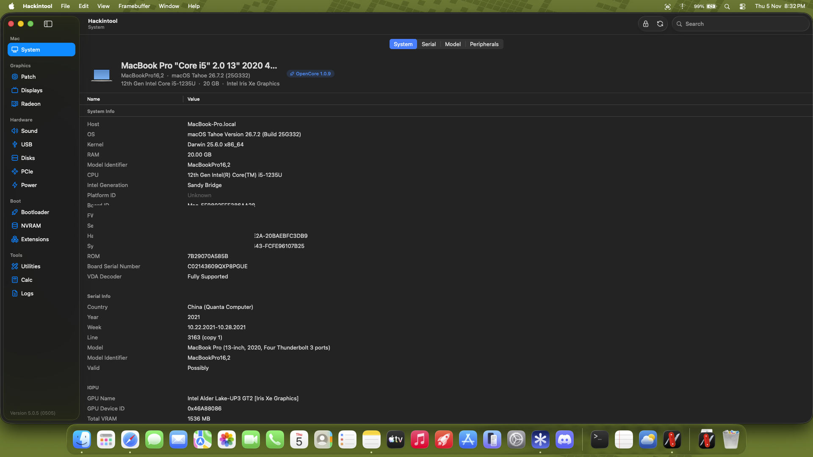
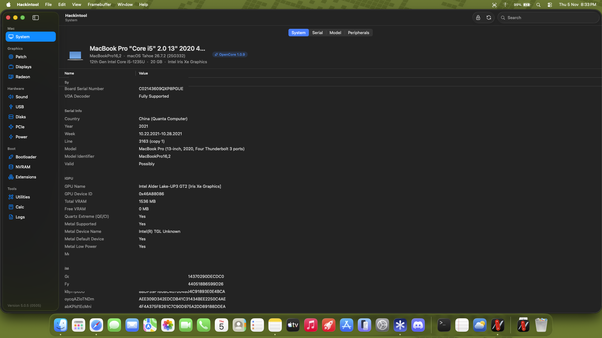
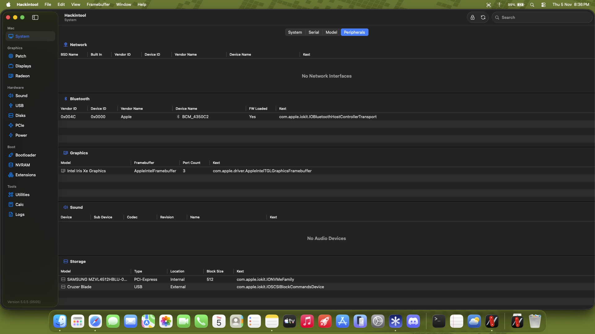
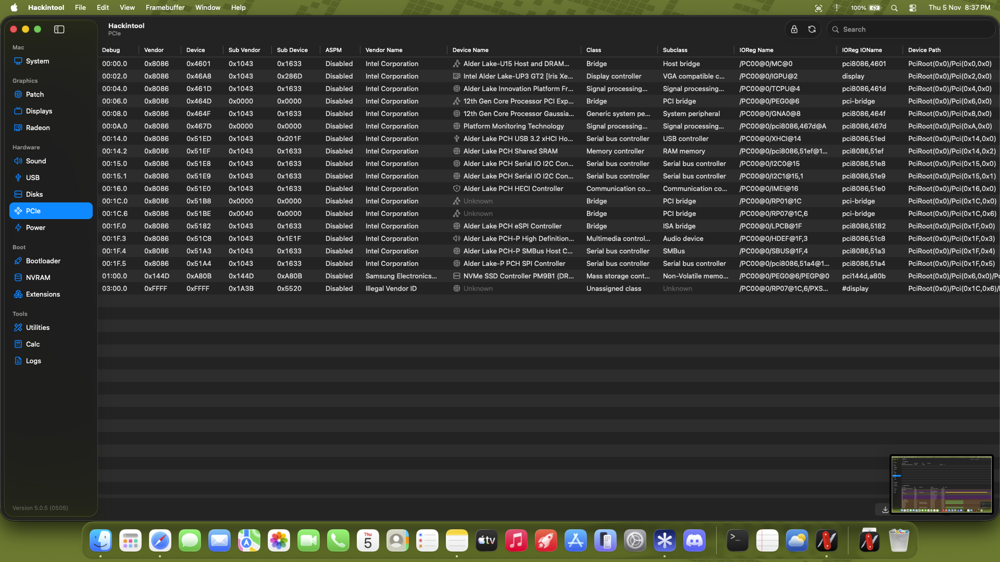

# ASUS Vivobook 15 (X1504ZA) — Complete macOS OpenCore Guide & EFI

[](https://www.apple.com/macos)
[](https://github.com/acidanthera/OpenCorePkg)
[-0071C5?style=for-the-badge&logo=intel)](https://www.intel.com)
[](https://www.intel.com)
[](https://github.com/jigyanshu-codes/SimpleMtkBtFw/releases/tag/v1.1.1)
[](#2-glitch-free-audio-internal-speakers-usb-dac--bluetooth)

A verified, actively maintained OpenCore `1.0.8` EFI and technical guide for running **macOS Tahoe (`26.7.2`)**, Sequoia, and Sonoma on the **ASUS Vivobook 15 (`X1504ZA` / `Vivobook_ASUSLaptop X1504ZA_X1504ZA`)** with **12th Gen Intel Core i5-1235U** and **Intel Iris Xe Graphics**.

> [!NOTE]
> **Project Status (Nov 2026 Breakthrough):**
> **Iris Xe 1536 MB Metal 2 acceleration, Internal Speakers + 3.5 mm Headphone Jack (`AppleALC` + `SimpleHDA`), USB DAC audio, MediaTek MT7902 Bluetooth + BT audio, I2C Trackpad, Display Backlight, Battery, and Custom USB Port Mapping are all verified working together on macOS Tahoe 26.7.2!**
> Native PCIe Wi-Fi (`MediaTek MT7902`) remains under active driver development ([SimpleMtkWlan](https://github.com/jigyanshu-codes/SimpleMtkWlan)), with iPhone/Android USB Tethering working out of the box.

---

## Screenshots & System Verification

| System Overview & Specs | Iris Xe Metal 2 Graphics Acceleration |
| :---: | :---: |
|  |  |

| Peripherals & Storage | Full PCIe Device Tree |
| :---: | :---: |
|  |  |

---

## Hardware Specifications & Compatibility

| Component | Hardware Details | Status | Notes |
| :--- | :--- | :---: | :--- |
| **Model** | ASUS Vivobook 15 `X1504ZA` / `Vivobook_ASUSLaptop X1504ZA_X1504ZA` | `Supported` | Motherboard ID: `X1504ZA` |
| **Processor** | Intel Core i5-1235U (10 Cores: 2P + 8E, Alder Lake-U) | `Working` | Native BIOS 10-thread topology + `CpuTscSync` (`TSC_sync_margin=0 -cputsclock`); `CpuTopologyRebuild` disabled |
| **Integrated GPU** | Intel Iris Xe Graphics GT2 (`8086:46A8`) | `Working` | 1536 MB VRAM, Metal 2, Full QE/CI via `WhateverXe v0.7.0` |
| **RAM** | 20 GB DDR4 3200 MHz (4 GB Onboard + 16 GB SO-DIMM) | `Working` | Dual-Channel |
| **Storage** | 512 GB Samsung PM9B1 NVMe SSD (`MZVL4512HBLU-00BTW`) | `Working` | Managed via `NVMeFix.kext v1.1.4` |
| **Display** | 15.6" Full HD (1920x1080) 60Hz eDP Panel | `Working` | Native brightness slider & Fn hotkeys |
| **Trackpad** | ASUS Precision Touchpad `ASUP1200` (`INTC1055` on I2C1 `00:15.1`) | `Working (Polling)` | Smooth cursor & clicks via `VoodooI2C v2.9.1` + `VoodooI2CHID` (`-vi2c-force-polling`) |
| **Keyboard** | ASUS I8042 PS/2 Keyboard | `Working` | `VoodooPS2Controller v2.3.8` + `BrightnessKeys v1.0.4` + `AsusSMC v1.4.1` |
| **Audio (Internal)** | Realtek ALC256 (`10EC:0256`) on Intel `8086:51C8` | `Working` | Speakers & 3.5 mm jack via `AppleALC v1.9.8` + `SimpleHDA v1.0.1` (`alcid=41`, in-RAM via Lilu) |
| **Audio (External)** | USB-C / USB-A DACs & Bluetooth Audio Devices | `Working` | `0` CoreAudio deadlines missed / `0` overloads (`AppleUSBAudio` + `SimpleMtkBtPatcher`) |
| **Bluetooth** | MediaTek MT7902 USB Bluetooth (AzureWave `13d3:3579`) | `Working` | Scanning, pairing, mic input & A2DP audio via [SimpleMtkBtFw v1.1.1](https://github.com/jigyanshu-codes/SimpleMtkBtFw/releases/tag/v1.1.1) |
| **Wi-Fi** | MediaTek Wi-Fi 6 MT7902 M.2 PCIe (`14C3:7902`) | `In Progress` | Driver under development ([SimpleMtkWlan](https://github.com/jigyanshu-codes/SimpleMtkWlan)); USB Tethering works out of the box |
| **Webcam** | ShineTech `USB2.0 HD UVC WebCam` (USB port `HS09`) | `Working` | Native plug-and-play |
| **USB Ports** | USB-C, USB-A 3.2, USB-A 2.0 + internal BT (`HS10`) & Cam (`HS09`) | `Working` | Custom 10-port `UTBMap.kext` + `USBToolBox v1.2.0` + `XHCI-unsupported v0.9.2` |
| **Battery / Power** | ASUS Battery & Power Telemetry | `Working` | Accurate readout & AC state via `SMCBatteryManager` + `AsusSMC` |

---

## Key Technical Breakthroughs & Fixes

### 1. Intel Iris Xe 1536 MB Metal 2 (`WhateverXe v0.7.0`)
Alder Lake-U integrated graphics (`8086:46A8`) require `WhateverXe.kext v0.7.0` paired with `WhateverXe-Graphics-0.4.0.pkg` in `/Library/Extensions` compiled into `AuxiliaryKernelExtensions.kc`:
* **Hardware Acceleration:** 1536 MB VRAM allocated, full Metal 2 (`QE/CI`) UI rendering, WebGL/WebGPU acceleration, and hardware video decode.
* **Native Display Backlight:** `SSDT-PNLF.aml` (`PNLF` → `XNLF` rename) + `AsusSMC.kext` + `BrightnessKeys.kext` provide full macOS Control Center slider and keyboard brightness control.
* **Strict Dependency Load Order:** `Lilu.kext` (`1.7.3`) → `AppleALC.kext` (`1.9.8`) → `SimpleHDA.kext` (`1.0.1`) → `AMFIPass.kext` (`1.4.1`) → `WhateverXe.kext` (`0.7.0`).

### 2. Glitch-Free Audio: Internal Speakers, USB DAC & Bluetooth
Earlier builds suffered severe CoreAudio stalls (~2 seconds of clean playback followed by crackling, cutouts, `273–330 ms` `scheduler_latency`, `Deadline is prior to Start time`, `Audio IO Overload`, and `0xE00002EE` `kIOReturnIsoTooOld` kernel errors) across **all** audio devices — Internal Speakers, Headphones, USB DACs, and Bluetooth.

#### A. Root Cause & CPU/TSC Fix
* Firmware on the X1504ZA boots with 10 threads exposed (`MP services threads 10 (enabled 10)`).
* Running `CpuTopologyRebuild.kext` (`ctrsmt=off`) together with OpenCore's `force HT enabled` kernel patches created a mismatched topology in XNU (`10` physical vs forced logical expectations), causing CoreAudio's real-time workgroups to wake hundreds of milliseconds past deadlines.
* **Solution in `config.plist`:**
  * Disabled `CpuTopologyRebuild.kext` and all 3 `force HT enabled` kernel patches (`Enabled = False`), keeping `Kernel -> Quirks -> ProvideCurrentCpuInfo = True`.
  * Enabled `CpuTscSync.kext` (`v1.1.3`) with `TSC_sync_margin=0 -cputsclock` in `boot-args`.
* **Verified Diagnostic Result (`audio_diag_report-6.txt`):** `Deadline prior to Start time: 0`, `Audio IO Overload: 0`, `Safety Violations: 0`, `PLAYBACK_TIME_MS: 1466.51 ms`.

#### B. Internal Speakers & 3.5 mm Jack on macOS Tahoe (`AppleALC` + `SimpleHDA`)
* Because Apple removed `AppleHDA.kext` starting in macOS Tahoe, [`SimpleHDA.kext`](https://github.com/laobamac/SimpleHDA) (`v1.0.1`) injects and restores the AppleHDA stack **strictly in RAM via OpenCore & Lilu** (`DisableLinkeditJettison = True`).
* **Why This Never Breaks Iris Xe Graphics:** Unlike legacy `HDAUniversal.kext` or `VoodooHDA.kext` installed to `/Library/Extensions` (which trigger `kmutil` rebuilds and hijack `8086:51C8`), `SimpleHDA.kext` writes nothing to macOS's disk or `AuxKC`.
* **Audio Properties:**
  * `DeviceProperties -> Add -> PciRoot(0x0)/Pci(0x1f,0x3)`: `layout-id` = `<29000000>` (`41`)
  * `boot-args`: `alcid=41 shda-lang=en` (adds clean English device labels)
* **Usage Note (`alcid=41`):** In **System Settings → Sound → Output**, `alcid=41` lists **`Built-in Speaker`** and **`Built-in Headphone`** as separate output entries. Select `Built-in Speaker` for internal speakers, or `Built-in Headphone` when using the 3.5 mm jack. *(If you prefer automatic jack switching on a single `Built-in Output` device, you can test changing `alcid=41` to `alcid=13` in `boot-args`.)*

### 3. MediaTek MT7902 Bluetooth (`13d3:3579`)
MediaTek MT7902 USB Bluetooth works natively with Bluetooth audio output, mic input, scanning, and pairing:
* **Kexts (`Kernel -> Add` order):** `BlueToolFixup.kext` (`2.7.2`) → `SimpleMtkBtFw.kext` (`1.1.1`) → `SimpleMtkBtPatcher.kext` (`1.1.1`) Mod from [SimpleMtkBtFw v1.1.1](https://github.com/jigyanshu-codes/SimpleMtkBtFw/releases/tag/v1.1.1).
* **NVRAM (`7C436110-AB2A-4BBB-A880-FE41995C9F82`):** `bluetoothInternalControllerInfo` (`14` zero bytes) and `bluetoothExternalDongleFailed` (`00`) present in both `Add` and `Delete`.
* **Boot Flags:** `-btlfxboardid -btlfxallowanyaddr` in `boot-args`.

### 4. Wi-Fi Workaround (MT7902 PCIe `14C3:7902`)
* The internal **MediaTek MT7902 PCIe Wi-Fi** card is disabled cleanly in ACPI (`SSDT-Disable_Network_RP07.aml`) while the open-source macOS driver is being developed at [SimpleMtkWlan](https://github.com/jigyanshu-codes/SimpleMtkWlan).
* **Zero-Cost Daily Option:** iPhone or Android **USB Tethering** works immediately out of the box (pair with [`Utilities/fix_tethering.sh`](Utilities/fix_tethering.sh) if hotspot drops on phone lock).
* **Hardware Upgrade Option:** Swapping the M.2 2230 card to an Intel `AX200 / AX201 / AX210` (`AirportItlwm`/`itlwm`) or Broadcom `BCM94360NG` enables onboard Wi-Fi.

---

## Post-Installation: Intel Iris Xe 1536 MB Acceleration Restorer

After installing macOS (or if macOS ever falls back to **Intel Iris Xe Graphics 7 MB** VESA mode), run our automated script to install/rebuild `WhateverXe-Graphics-0.4.0` into `AuxiliaryKernelExtensions.kc`:

```bash
sudo ./Utilities/activate_acceleration.sh
```
*(Or double-click [`Utilities/Restore_1536MB_Acceleration.command`](Utilities/Restore_1536MB_Acceleration.command) in Finder.)*

### What `activate_acceleration.sh` Automates
1. Purges any conflicting `/Library/Extensions` audio kexts (`HDAUniversal.kext`, `VoodooHDA.kext`, `AppleHDADisabler.kext`).
2. Clears macOS extension staging (`kmutil clear-staging`).
3. Locates or downloads `WhateverXe-Graphics-0.4.0.pkg` and validates `/Library/Extensions/AppleIntelTGL*` + `/Library/GPUBundles`.
4. Enforces `root:wheel` `755` permissions, clears quarantine attributes (`xattr -cr`), and disables `AllowOnePassMetalScaling` in `CoreMedia.plist`.
5. Builds `/Library/KernelCollections/AuxiliaryKernelExtensions.kc` via `kmutil create -n aux --allow-missing-kdk --no-authentication`.

> [!CAUTION]
> ### CRITICAL: Avoid The "System Settings Trap"
> When `activate_acceleration.sh` completes, macOS may show *"System Extension Blocked"*.
>
> 1. **DO NOT open System Settings → Privacy & Security!**
> 2. **DO NOT click 'Allow' or 'Restart' inside System Settings!**
>
> Clicking Restart inside System Settings runs macOS's `kmutil rebuild` **without** `--allow-missing-kdk`, wiping your Iris Xe drivers back to 7 MB VESA mode.
>
> **Safe Reboot:** Press **`[Enter]`** directly in the Terminal script prompt → press **Spacebar → Reset NVRAM** once at the OpenCore picker → boot macOS normally.

---

## Installation & Setup Guide

### 1. BIOS Settings (F2)
* **Disable:** Secure Boot, Fast Boot, Intel VMD / RAID (`VMD Configuration` → `Disabled` / AHCI).
* **Enable:** Intel Virtualization Technology (`VT-x`).

### 2. Generate Unique SMBIOS Before Booting (`MacBookPro16,2`)
> [!IMPORTANT]
> The [`EFI/OC/config.plist`](EFI/OC/config.plist) in this repository contains sanitized placeholder serial numbers (`C02000000000`). Generate your own unique SMBIOS values before signing into Apple ID / iCloud!

Use **[GenSMBIOS](https://github.com/corpnewt/GenSMBIOS)** for **`MacBookPro16,2`** (see [`Utilities/generate_smbios.md`](Utilities/generate_smbios.md)) and update `PlatformInfo -> Generic` (`SystemSerialNumber`, `MLB`, `SystemUUID`, `ROM`) in ProperTree.

### 3. Deploy to USB & Boot
1. Copy the [`EFI/`](EFI/) folder from this repository to the root of your FAT32 EFI partition (test on a USB drive first before touching your internal SSD!).
2. **Never delete or overwrite `EFI/Microsoft` on your internal NVMe SSD** when dual-booting Windows.
3. Boot via **Esc** → select USB UEFI → press **Spacebar → Reset NVRAM** on first boot → boot macOS.

---

## Post-Installation Utilities

Bundled in [`Utilities/`](Utilities/) (all Unix LF line endings):
* [`activate_acceleration.sh`](Utilities/activate_acceleration.sh) & [`Restore_1536MB_Acceleration.command`](Utilities/Restore_1536MB_Acceleration.command) — Installs/restores 1536 MB Iris Xe Metal 2 `AuxKC` cleanly.
* [`fix_tethering.sh`](Utilities/fix_tethering.sh) — Restarts `usbmuxd` and cycles the iPhone USB Ethernet interface without rebooting.
* [`optimize_power.sh`](Utilities/optimize_power.sh) — Configures `pmset` (disables hibernation/sleepimage to keep USB peripherals stable).
* [`generate_smbios.md`](Utilities/generate_smbios.md) — Step-by-step GenSMBIOS guide for `MacBookPro16,2`.

---

## Repository Structure

```text
├── EFI/
│   ├── BOOT/
│   │   └── BOOTx64.efi                         # OpenCore 1.0.8 UEFI Bootloader
│   └── OC/
│       ├── ACPI/
│       │   ├── DSDT.aml                        # Patched DSDT (GPI0 INTC1055, I2C timings)
│       │   ├── SSDT-ALS0.aml                   # Ambient Light Sensor dummy
│       │   ├── SSDT-Disable_Network_RP07.aml   # Disables unsupported MT7902 PCIe Wi-Fi slot
│       │   ├── SSDT-EC.aml                     # Embedded Controller fix
│       │   ├── SSDT-GPI0.aml                   # GPIO controller enablement
│       │   ├── SSDT-HPET.aml                   # Included (Disabled in config.plist)
│       │   ├── SSDT-MCHC.aml                   # SMBus / Memory controller
│       │   ├── SSDT-PLUG-ALT.aml               # Alder Lake CPU power management
│       │   ├── SSDT-PNLF.aml                   # Internal eDP backlight control
│       │   ├── SSDT-RMNE.aml                   # NullEthernet built-in en0
│       │   ├── SSDT-RTCAWAC.aml                # System clock (AWAC/RTC) fix
│       │   ├── SSDT-SBUS.aml                   # SMBus device properties
│       │   ├── SSDT-USB-Reset.aml              # RHUB USB reset
│       │   ├── SSDT-USBX.aml                   # USB power properties
│       │   └── SSDT-XOSI.aml                   # _OSI Windows simulation
│       ├── Drivers/                            # OpenRuntime, HfsPlus, ResetNvramEntry, OpenCanopy
│       ├── Kexts/
│       │   ├── Lilu.kext                       # v1.7.3 — Base kernel patcher
│       │   ├── AppleALC.kext                   # v1.9.8 — Realtek ALC256 codec (alcid=41)
│       │   ├── SimpleHDA.kext                  # v1.0.1 — In-RAM AppleHDA restoration on Tahoe
│       │   ├── AMFIPass.kext                   # v1.4.1 — AMFI compatibility for WhateverXe
│       │   ├── WhateverXe.kext                 # v0.7.0 — Patched Iris Xe Metal 2 driver
│       │   ├── BlueToolFixup.kext              # v2.7.2 — macOS Bluetooth stack fixup
│       │   ├── SimpleMtkBtFw.kext              # v1.1.1 — MediaTek MT7902 firmware loader
│       │   ├── SimpleMtkBtPatcher.kext         # v1.1.1 — MediaTek Bluetoothd/Audio patcher
│       │   ├── VirtualSMC.kext                 # v1.3.9 — SMC emulator
│       │   ├── AsusSMC.kext                    # v1.4.1 — ASUS laptop Fn & fan controls
│       │   ├── SMCBatteryManager.kext          # v1.3.9 — Battery telemetry
│       │   ├── BrightnessKeys.kext             # v1.0.4 — Native brightness hotkeys
│       │   ├── CpuTscSync.kext                 # v1.1.3 — TSC sync across P/E cores
│       │   ├── CpuTopologyRebuild.kext         # Disabled in config.plist (see Audio Fix)
│       │   ├── NVMeFix.kext                    # v1.1.4 — NVMe power management
│       │   ├── NullEthernet.kext               # v1.0.6 — Built-in en0 for Apple services
│       │   ├── RestrictEvents.kext             # v1.1.7 — Platform/CPU restriction patches
│       │   ├── USBToolBox.kext                 # v1.2.0 — Custom USB mapping engine
│       │   ├── UTBMap.kext                     # v1.0 — X1504ZA 10-port USB map (UTBDefault disabled)
│       │   ├── VoodooI2C.kext                  # v2.9.1 — Alder Lake I2C bus driver
│       │   ├── VoodooI2CHID.kext               # I2C HID touchpad driver (polling mode)
│       │   ├── VoodooPS2Controller.kext        # v2.3.8 — Built-in PS/2 keyboard
│       │   └── XHCI-unsupported.kext           # v0.9.2 — Alder Lake-P XHCI 8086:51ED matching
│       ├── Resources/                          # OpenCanopy GoldenGate theme & resources
│       └── config.plist                        # OpenCore 1.0.8 config (sanitized SMBIOS)
├── Screenshots/                                # System proof screenshots
├── Utilities/                                  # Post-install & recovery scripts
└── README.md                                   # Documentation
```

---

## Credits & Acknowledgements

* **[Acidanthera](https://github.com/acidanthera)** — OpenCorePkg, Lilu, VirtualSMC, AppleALC, BrcmPatchRAM (`BlueToolFixup`), NVMeFix, RestrictEvents, VoodooPS2, BrightnessKeys
* **[WhateverXe Team (`b00t0x`)](https://github.com/b00t0x/WhateverXe)** — Pioneering Intel Iris Xe graphics acceleration on macOS
* **[laobamac](https://github.com/laobamac)** — `SimpleHDA` (`cn.laobamac.SimpleHDA`) & upstream `SimpleMtkBtFw`
* **[flxxxxddd](https://github.com/flxxxxddd/SimpleMtkBtFw)** — `SimpleMtkBtFw` connac2 improvements & AirPods/BT audio patcher
* **[jigyanshu-codes](https://github.com/jigyanshu-codes/SimpleMtkBtFw/releases/tag/v1.1.1)** — MediaTek MT7902 (`0x7902` / `13d3:3579`) firmware support, X1504ZA Alder Lake CoreAudio timing fix, and end-to-end verification
* **[Alexandred](https://github.com/alexandred)** & **[CoolStar](https://github.com/coolstar)** — `VoodooI2C` & `VoodooGPIO`
* **[DhinakG / USBToolBox](https://github.com/USBToolBox)** — `USBToolBox` & custom port mapping
* **[hieplpvip](https://github.com/hieplpvip/AsusSMC)** & **[lvs1974](https://github.com/lvs1974/CpuTscSync)** — `AsusSMC` & `CpuTscSync`
* **[Dortania](https://dortania.github.io/)** — OpenCore Install & ACPI Guides
* **[Belugaa_01](https://www.reddit.com/user/Belugaa_01/)** — Initial Alder Lake-U WhateverXe offset discovery

---

### Community & Support
If this repository helped you get your ASUS Vivobook or Alder Lake laptop running macOS smoothly with Metal 2 graphics, speakers, and MT7902 Bluetooth, please leave a Star on GitHub!
